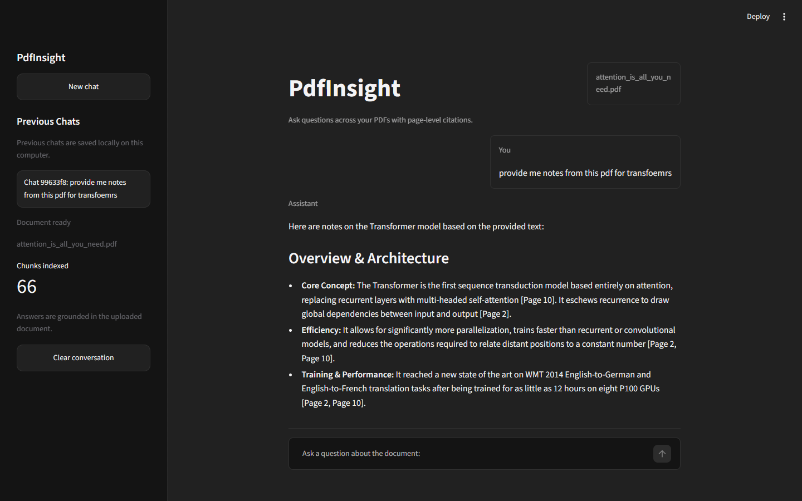
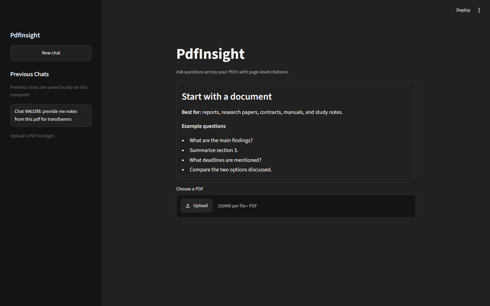
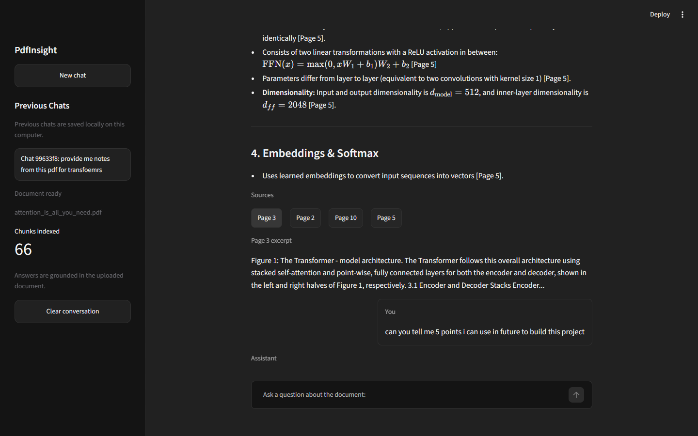
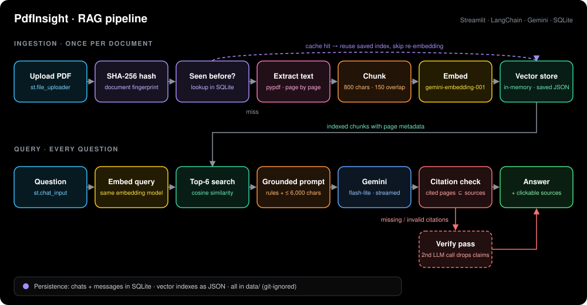

<div align="center">

# PdfInsight

**Chat with any PDF and get grounded answers with page-level citations.**


<br><br>

<a href="https://pdf-insight-365.streamlit.app/"></a>

<br><br>



</div>

---

## Overview

PdfInsight is a **retrieval-augmented generation (RAG)** app for question answering over PDFs. Upload a document and ask questions in plain English. The app finds the passages most relevant to your question, has Gemini answer **only from those passages**, and shows the source pages so you can check every claim yourself.

**Why it's useful:** general chatbots answer from memory and can make things up. PdfInsight answers from *your* document. When the answer isn't there, it says so instead of guessing.

## Live demo

**▶ [pdf-insight-365.streamlit.app](https://pdf-insight-365.streamlit.app/)**: upload a PDF and start asking questions. No setup needed.

> [!WARNING]
> The demo is a shared public instance. Chat history is visible to every visitor and is wiped whenever the app restarts, so **don't upload private documents**. Uploads run fully locally; answers use Gemini's free tier, so answering may be briefly unavailable if its daily quota is used up.

## Features

| | Feature | Details |
|:-:|---|---|
| 📄 | **PDF ingestion** | Page-by-page text extraction with `pypdf`, plus a warning for scanned or low-text PDFs |
| 🔎 | **Semantic search** | Local Hugging Face embeddings (`BAAI/bge-small-en-v1.5`) + cosine similarity retrieve the top-6 most relevant chunks, with no API key or quota |
| 📌 | **Page citations** | Every factual claim is cited as `[Page N]`; click a page to view the exact excerpt used |
| 🛡️ | **Hallucination guards** | Strict grounded prompt, a fixed "not found" reply, citation validation, and an automatic verification pass |
| ⚡ | **Streaming answers** | Responses appear token by token |
| 💾 | **Persistent chats** | Chat history in SQLite; reopen any previous conversation from the sidebar |
| ♻️ | **Index caching** | SHA-256 fingerprint of each PDF: re-uploading the same file reuses its saved index with no new embedding calls |

## Screenshots

<table>
  <tr>
    <td width="33%"></td>
    <td width="33%"></td>
    <td width="33%"></td>
  </tr>
  <tr>
    <td align="center"><b>Upload</b><br><sub>Start a chat and reopen past ones from the sidebar</sub></td>
    <td align="center"><b>Grounded answer</b><br><sub>Structured notes with <code>[Page N]</code> citations</sub></td>
    <td align="center"><b>Source excerpts</b><br><sub>Click a page to see the passage used</sub></td>
  </tr>
</table>

## How it works



**Ingestion (once per document)**
1. **Fingerprint:** the PDF's SHA-256 hash is looked up in SQLite. On a cache hit, the saved vector index is loaded and steps 2–4 are skipped.
2. **Extract:** `pypdf` reads text page by page, and each page keeps its page number as metadata.
3. **Chunk:** `RecursiveCharacterTextSplitter` splits text into 800-character chunks with a 150-character overlap, preferring paragraph and sentence boundaries.
4. **Embed and store:** chunks are embedded **locally on CPU** with Hugging Face `BAAI/bge-small-en-v1.5` and indexed in a **FAISS** vector database (inner product on normalised vectors = cosine similarity), which is saved to disk per document.

**Query (every question)**

5. **Retrieve:** the question is embedded with the same model, and the 6 most similar chunks are returned.
6. **Prompt:** chunks are labelled `[Source N | Page P]` and capped at 6,000 characters, then wrapped in strict grounding rules.
7. **Generate:** Gemini streams the answer.
8. **Verify:** if the answer has no citations, or cites a page that wasn't retrieved, a second LLM pass checks it against the context and removes unsupported claims.

## Tech stack

| Layer | Technology | Why |
|---|---|---|
| UI |  | Fast to build, with chat widgets and streaming built in |
| PDF parsing |  | Pure Python, no system dependencies |
| Chunking |  | Recursive splitter respects natural text boundaries |
| Embeddings |  | Strong retrieval model (384 dimensions) that runs locally: free, private and unaffected by API quotas |
| Vector database |  | Meta's library for fast nearest-neighbour search; runs in-process with no server and saves to disk |
| LLM |  | Low latency, low cost, supports streaming |
| Storage |  | Zero-setup persistence for chats and index metadata |

## Getting started

### Prerequisites
- Python 3.11 or newer (developed on 3.14)
- A free Gemini API key from [Google AI Studio](https://aistudio.google.com/apikey)

### Install

```bash
git clone https://github.com/sidhantds/pdf-insight.git
cd pdf-insight

python -m venv env
env\Scripts\activate          # Windows
# source env/bin/activate     # macOS / Linux

pip install -r requirements.txt
```

### Configure

Copy `.env.example` to `.env` and add your key:

```env
GEMINI_API_KEY=your_gemini_api_key_here
```

> [!IMPORTANT]
> `.env` is git-ignored. Never commit a real API key.

### Run

```bash
streamlit run app.py
```

Then open **http://localhost:8501**.

## Usage

1. Upload a **text-based** PDF (reports, papers, manuals, notes).
2. Wait for processing: *Reading → Chunking → Embedding*.
3. Ask a question, or click one of the suggested questions.
4. Click a **Page N** button under an answer to see the excerpt it came from.
5. Use **New chat** to start over, or pick a previous chat in the sidebar.

**Example** (*Attention Is All You Need*):

```text
Q: provide me notes from this pdf for transformers
A: Core Concept: The Transformer is the first sequence transduction model based
   entirely on attention, replacing recurrent layers with multi-headed
   self-attention [Page 10]. It eschews recurrence to draw global dependencies
   between input and output [Page 2]. ...

Q: can you tell me 5 points i can use in future to build this project
A: I could not find enough information in this document to answer that question.
```

The second answer is the app **correctly refusing**: the paper doesn't contain that information, so it doesn't make it up.

## Project structure

```text
pdf-insight/
├── app.py              # Streamlit UI: upload flow, chat, sources, sidebar history
├── rag.py              # Parsing, chunking, embeddings, retrieval, prompts, citation checks
├── storage.py          # SQLite schema, chat/message persistence, vector index save/load
├── docs/
│   ├── pipeline.svg    # Architecture diagram
│   └── screenshots/
├── .streamlit/
│   └── config.toml     # Dark theme
├── requirements.txt
├── .env.example
├── .gitignore
└── LICENSE
```

## Configuration

| Setting | Value | Location | Effect |
|---|---|---|---|
| `CHUNK_SIZE` | `800` | `rag.py` | Characters per chunk |
| `CHUNK_OVERLAP` | `150` | `rag.py` | Characters shared between neighbouring chunks |
| `RETRIEVAL_K` | `6` | `rag.py` | Chunks retrieved per question |
| `MAX_CONTEXT_CHARS` | `6000` | `rag.py` | Hard cap on context sent to the LLM |
| `EMBEDDING_MODEL_NAME` | `BAAI/bge-small-en-v1.5` | `rag.py` | Local Hugging Face model for chunk and question vectors |
| Chat model | `gemini-3.5-flash-lite` | `app.py` | Answer generation and verification |
| `GEMINI_API_KEY` | your key | `.env` | Authentication for Gemini |

## Design decisions

| Decision | Why | Trade-off |
|---|---|---|
| 800 / 150 chunking | Small enough for precise retrieval, large enough to keep context | Facts that span several chunks can be split |
| Top-6 retrieval + 6k-char cap | Broad evidence while keeping the prompt focused and cheap | Whole-document summaries only see a fraction of a long PDF (~4,800 of ~40,000 chars for the sample paper) |
| Fixed refusal sentence | Lets the model admit "not found", and the app can detect it | Can be over-cautious on loosely worded questions |
| Citation validation + verification pass | Catches invented or missing page numbers automatically | Adds a second LLM call, but only when the check fails |
| Local Hugging Face embeddings | Uploads never hit an API quota; document text isn't sent anywhere to be embedded | ~130 MB model download on first start; CPU embedding is slower than an API for very large PDFs |
| SHA-256 index cache | Same PDF is never embedded twice, saving latency and quota | Indexes are tied to the embedding model that built them |
| Local SQLite + FAISS files | Zero infrastructure; chats survive restarts | Single-user and single-machine by design |

## Evaluation

A formal evaluation is **planned, not yet run**. The intended methodology:

| Metric | How it will be measured |
|---|---|
| Retrieval hit rate | % of questions whose gold passage appears in the top-6 |
| Answer correctness | Hand-graded against reference answers |
| Citation accuracy | % of cited pages that actually contain the claim |
| Refusal correctness | % of unanswerable questions correctly refused |
| Latency | Median and p95 time to first token and to full answer |

> No numbers are reported until they are measured.

## Limitations

- **Text-based PDFs only.** Scanned pages and images aren't OCR'd.
- **Tables, charts and multi-column layouts** may extract out of order.
- **No conversational memory.** Each question is answered on its own, so follow-ups like *"explain that more simply"* lack context.
- **Exact (flat) FAISS index.** Ideal for single documents; very large collections would switch to an approximate index such as IVF or HNSW.
- **FAISS fallback.** FAISS is a compiled library. On machines that block it (for example Windows Smart App Control), the app logs a warning and uses LangChain's in-memory vector store instead, so it keeps working with the same results.
- **Shared, single-instance storage.** All chats are visible to anyone using the same instance (including the public demo), and Streamlit Cloud doesn't keep local files across restarts.
- **Free-tier quotas.** Answers use Gemini's free tier, which limits daily requests. Uploads and search are local and unaffected.
- **First upload is slower.** The embedding model (~130 MB) downloads once when the app first starts.

## Security & privacy

- API keys load from `.env`, which is git-ignored. `.env.example` holds a placeholder only.
- Uploaded documents, chat history and vector indexes stay on your machine in `data/` (git-ignored).
- Retrieved PDF text is sent to the Gemini API to generate answers. Don't upload confidential or regulated documents.

## Roadmap

- [ ] Conversational memory (rewrite follow-up questions using chat history)
- [ ] Hybrid search (BM25 + embeddings) and cross-encoder re-ranking
- [ ] OCR for scanned PDFs
- [ ] Multi-PDF chats with per-document filters
- [ ] Evaluation suite and automated tests
- [ ] Per-user storage and Docker deployment

## License

Released under the [MIT License](LICENSE).
